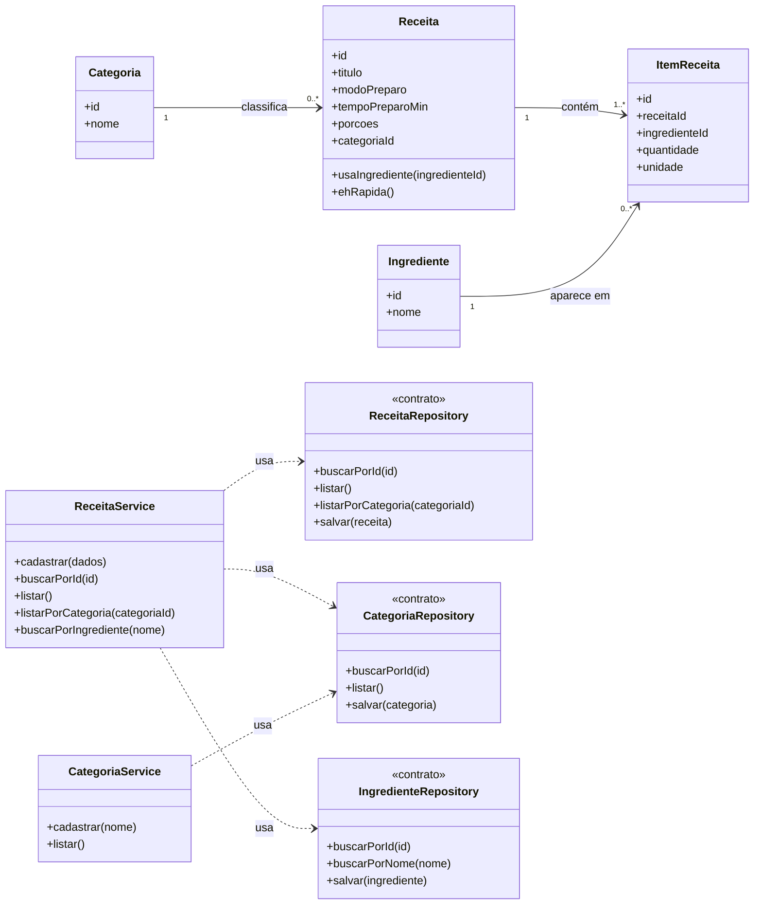

# Modelagem — Projeto 1

**Aluno(a):** Seu Nome Completo
**Domínio:** Catálogo de receitas culinárias

## 1. O domínio

O catálogo guarda receitas organizadas por categoria (sobremesa, massa, salada etc.).
Cada receita tem um modo de preparo e uma lista de itens, e cada item indica qual
ingrediente é usado e em que quantidade. Um mesmo ingrediente pode aparecer em várias
receitas. O usuário pode cadastrar receitas, listá-las, filtrar por categoria e buscar
receitas que usem determinado ingrediente.

## 2. Entidades

| Entidade | Atributos | Relacionamentos |
|---|---|---|
| Categoria | id, nome | agrupa várias receitas |
| Receita | id, titulo, modoPreparo, tempoPreparoMin, porcoes, categoriaId | pertence a uma categoria e tem vários itens |
| Ingrediente | id, nome | aparece em vários itens de receita |
| ItemReceita | id, receitaId, ingredienteId, quantidade, unidade | pertence a uma receita e a um ingrediente |

## 3. Diagrama de classes

## 4. Responsabilidades

| Classe | Papel | Único motivo para mudar |
|---|---|---|
| Categoria, Receita, Ingrediente, ItemReceita | entidades | as regras do próprio objeto (ex.: quando uma receita é considerada rápida) |
| ReceitaService | regra de negócio | o processo de cadastrar, listar e buscar receitas |
| CategoriaService | regra de negócio | o processo de cadastrar e listar categorias |
| ReceitaRepository, CategoriaRepository, IngredienteRepository | acesso aos dados | a forma de guardar (memória na S3, SQLite na S5) |

## 5. Onde apliquei SRP e DIP

- **SRP:** nenhuma entidade salva a si mesma. Guardar é papel dos repositories;
  o processo fica nos services. Os métodos de `Receita` só consultam o próprio
  estado (`usaIngrediente`, `ehRapida`).
- **DIP:** `ReceitaService` e `CategoriaService` dependem apenas dos contratos
  dos repositories, recebidos pelo construtor. Eles não sabem se os dados estão
  em memória ou em um banco.

## 6. Fora do escopo (YAGNI)

Login, avaliações e notas, favoritos, upload de fotos, lista de compras e
cálculo nutricional não entram no Projeto 1. O `ItemReceita` não tem repository
próprio: ele é salvo junto com a `Receita`. O `Ingrediente` também não tem service
próprio: o `ReceitaService` cuida de achar ou criar ingredientes ao cadastrar.